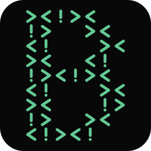

  

<h1 align="center">Beri Contraster</h1>

Offensive security, practical research, and lessons learned by exploring how systems break.

  
  
  

## Whoami

I'm Muhammad Zubair, known online as **Beri Contraster**. I work in offensive security and penetration testing, looking for the weaknesses that can connect into real attack paths.

I enjoy understanding how systems behave under pressure, building labs to explore security issues safely, and sharing what I learn in clear, practical writeups.

## What my website is for

[**bericontraster.com**](https://bericontraster.com) is where I share my security research, guides, walkthroughs, and projects. It is for people who want to understand how vulnerabilities work, practice offensive security, and learn from real technical investigations.

You can explore:

- Vulnerability research and CVE breakdowns
- Web, API, Linux, and Active Directory security guides
- HackTheBox and lab walkthroughs
- **BlackSite**, my collection of vulnerable environments for hands-on practice
- Projects, tools, and notes from my security work

The aim is to make the reasoning behind an attack path understandable and useful, whether you are building your skills or improving how you defend systems.
