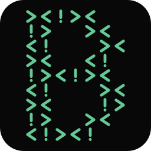

  

<h1 align="center">Beri Contraster</h1>

Security research, practical labs, and lessons from breaking things to understand them.

  <a href="https://bericontraster.com">Website</a> ?
  <a href="https://www.linkedin.com/in/mhamd-zubair/">LinkedIn</a> ?
  <a href="mailto:contact@bericontraster.com">Contact</a>

## The Person Behind the Research

I'm Muhammad Zubair, known online as **Beri Contraster**. I'm a cybersecurity professional focused on penetration testing and offensive security. I enjoy tracing how small weaknesses connect into larger attack paths, building vulnerable environments to explore those ideas, and turning what I learn into clear, practical explanations.

My writing shares the process behind the result: what I enumerated, why a technique worked, where I got stuck, and what the experience taught me.

## A Place to Learn, Test, and Build

[**bericontraster.com**](https://bericontraster.com) brings together my security research, technical guides, CTF walkthroughs, and projects. Topics range from Active Directory and web application security to reverse engineering, detection labs, and getting started in cybersecurity.

You'll also find **BlackSite**, my collection of vulnerable lab machines built for hands-on practice. Whether you're following an attack chain or building your first lab, the aim is to help you understand the underlying systems and develop a method you can use yourself.

## Built for Reading and Exploration

The site uses **HTML, CSS, and vanilla JavaScript**, with a custom **Node.js** build that turns Markdown articles into static pages. **markdown-it** renders the content, **YAML** provides article metadata, and **Prism** adds code highlighting during the build.

**GitHub Actions** builds and validates the site before deployment to **GitHub Pages**. Search, related articles, a floating table of contents, and responsive layouts make the growing collection easier to explore.
